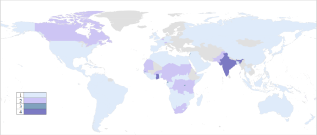
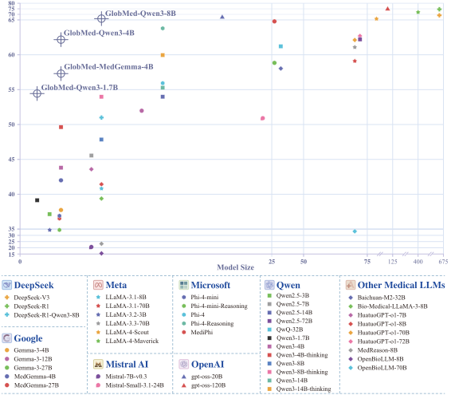

# 🌍 Toward Global Large Language Models in Medicine

<p align="center">
 
 
 
</p>

<p align="center">
  <a href="https://arxiv.org/abs/2601.02186"><b>[📜 Paper]</b></a> •
  <a href="https://huggingface.co/collections/ruiyang-medinfo/globmed"><b>[🤗 HuggingFace]</b></a>
</p>

## 📢 News
- **[2025.01.25]** 🔥 GlobMed has been expanded to cover 20 languages, with the addition of PubMedQA and MedMCQA. 
- **[2025.01.08]** 🔥 GlobMed is publicly available through the Hugging Face platform.  

## GlobMed
We introduce GlobMed, the largest multilingual medical dataset to date, spanning 20 languages.

### Scale & Coverage
- **800,000+ entries**
- **20 languages**
  - High-resource: Arabic, Chinese, English, French, German, Hindi, Indonesian, Japanese, Korean, Portuguese, Russian, Spanish, Thai
  - Low-resource: Bengali, Malay, Swahili, Urdu, Wolof, Yoruba, Zulu
 
<p align="center">
  
</p>

### Core Tasks
- **Natural Language Inference:** BioNLI, MedNLI
- **Long-Form Question Answering:** ExpertQA-Bio, ExpertQA-Med, LiveQA 
- **Multiple-choice Question Answering:** HeadQA, MedExpQA, MedMCQA, MedQA, MMLU-Pro, PubMedQA  

## GlobMed-Bench

Building on GlobMed, we establish GlobMed-Bench, which systematically assesses 56 state-of-the-art LLMs across multiple multilingual medical tasks.

### Evaluation Scope
- **56 state-of-the-art LLMs**
- **20,000+ independent experiments**
- **32M+ generated responses**

### Overall Performance of 12 Proprietary LLMs
    <p align="center">
      
    </p>
### Overall Performance of 44 Open-Weight LLMs
    <p align="center">
      
    </p>
    

### Key Findings
- Proprietary LLMs generally achieve stronger overall performance
- Open-Weight LLMs exhibit significant performance variance and demonstrate a scaling law
- LLMs show significant performance disparities across languages, especially on low-resource languages
- Reasoning-enhanced LLMs consistently outperform non-reasoning counterparts  
- Medical LLMs do not consistently outperform their general counterparts

## GlobMed-LLMs
We introduced GlobMed-LLMs, a suite of multilingual medical LLMs trained on GlobMed, with parameters ranging from 1.7B to 8B.

<p align="center">
  
</p>

## Usage

### Load Dataset

```python
from datasets import load_dataset

# load GlobMed-MMLU-Pro (English)
globmed_mmlu_pro = load_dataset("ruiyang-medinfo/GlobMed_MMLU-Pro", "en")

globmed_mmlu_pro_train = globmed_mmlu_pro["train"]
globmed_mmlu_pro_test = globmed_mmlu_pro["test"]
```

## Running Evaluation

### Installation

#### Basic Installation

```bash
# Create environment
conda create -n globalmed python=3.10 -y && conda activate globalmed

# Install project
pip install -e .
```

#### vLLM Installation (Optional)

For local inference with vLLM:

```bash
pip install -e ".[vllm]"
```

#### Environment Variables

Copy the environment template and fill in your API keys:

```bash
cp .env.example .env
# Edit .env file with your API keys
```

The `.env` file supports the following configurations:

```bash
# OpenAI / OpenRouter / Local vLLM serve
OPENAI_BASE=https://api.openai.com/v1
OPENAI_KEY=your-api-key

# Azure OpenAI
AZURE_OPENAI_BASE=https://your-resource.openai.azure.com/
AZURE_OPENAI_KEY=your-azure-key
AZURE_OPENAI_API_VERSION=2024-12-01-preview
AZURE_OPENAI_DEPLOYMENT=gpt-4o

# HuggingFace (for dataset download)
HF_TOKEN=hf_...
```

### Option 1: Commercial API

Using OpenAI, OpenRouter, or other commercial APIs:

```bash
# Set environment variables
export OPENAI_BASE="https://api.openai.com/v1"
export OPENAI_KEY="your-api-key"

# Run evaluation (single language)
python -m globalmed.run_openai \
    --model_id "gpt-4o" \
    --subset "MedQA" \
    --lang "en" \
    --n_thread 32

# Run evaluation (all languages)
python -m globalmed.run_openai \
    --model_id "gpt-4o" \
    --subset "MedQA" \
    --n_thread 32
```

**Using Azure OpenAI**:

```bash
export AZURE_OPENAI_BASE="https://your-resource.openai.azure.com/"
export AZURE_OPENAI_KEY="your-key"
export AZURE_OPENAI_API_VERSION="2024-12-01-preview"

python -m globalmed.run_openai \
    --model_id "gpt-4o" \
    --subset "MedQA" \
    --use_azure \
    --n_thread 32
```

### Option 2: Local Model (vLLM serve)

Start a vLLM server first, then use the OpenAI-compatible interface:

**Step 1: Start vLLM Server**

```bash
# Basic startup
vllm serve Qwen/Qwen3-8B --port 8000

# Enable thinking mode (Qwen3 series)
vllm serve Qwen/Qwen3-8B --port 8000 --reasoning-parser qwen3

# Multi-GPU tensor parallel
vllm serve Qwen/Qwen3-30B-A3B --port 8000 --tensor-parallel-size 4
```

**Step 2: Run Evaluation**

```bash
export OPENAI_BASE="http://localhost:8000/v1"
export OPENAI_KEY="EMPTY"

python -m globalmed.run_openai \
    --model_id "Qwen/Qwen3-8B" \
    --subset "MedQA" \
    --n_thread 64
```

### Option 3: Local Offline Inference (vLLM)

Use vLLM directly for batch offline inference:

```bash
python -m globalmed.run_vllm \
    --model_id "meta-llama/Llama-3.3-70B-Instruct" \
    --subset "MedQA" \
    --tensor_parallel_size 4 \
    --batch_size 128
```

### Resuming Failed Inference

If some samples fail during inference (due to API errors, timeouts, etc.), the script will print a warning at the end:

```
WARNING - X items missing from JSON export
WARNING - Missing IDs (first 5): [...]
```

If you see this warning, **re-run the same command** to resume and fill in the failed samples. The script automatically detects completed samples and only processes the missing ones. This ensures fair scoring with complete results.

### Viewing Results

#### View Results Table

```bash
python -m globalmed.pretty_print --subset "MedQA"
```

Output example:

```
Dataset: MedQA (shot) [run_idx=0]
Models found: 2
+------------------+-------+-------+-------+-------+-------+-------+-------+-------+------+------+------+------+
|      Model       |  en   |  zh   |  fr   |  de   |  ja   |  ko   |  pt   |  es   |  sw  |  wo  |  yo  |  zu  |
+------------------+-------+-------+-------+-------+-------+-------+-------+-------+------+------+------+------+
|    model-a       | xx.xx | xx.xx | xx.xx | xx.xx | xx.xx | xx.xx | xx.xx | xx.xx |xx.xx |xx.xx |xx.xx |xx.xx |
|    model-b       | xx.xx | xx.xx | xx.xx | xx.xx | xx.xx | xx.xx | xx.xx | xx.xx |xx.xx |xx.xx |xx.xx |xx.xx |
+------------------+-------+-------+-------+-------+-------+-------+-------+-------+------+------+------+------+
```

#### Filter by Languages

```bash
python -m globalmed.pretty_print --subset "MedQA" --lang en zh fr de
```

### Result File Formats

Results are stored in `results/{model_id}/{subset}_{prompt_style}/`:

#### JSONL Intermediate Results

Each line is a JSON object for one sample.

**run_openai.py format**:

```json
{
  "id": "MedQA_en_0",
  "request": "[{\"role\": \"user\", \"content\": \"...\"}]",
  "responses": [
    {"content": "Let me analyze... The answer is (A).", "reasoning": null, "answer": "A"}
  ],
  "metadata": {"id": "MedQA_en_0", "question": "...", "options": {"A": "...", "B": "..."}, "answer_index": 0}
}
```

**run_vllm.py format**:

```json
{
  "id": "MedQA_en_0",
  "request": "<|im_start|>user\n...<|im_end|>\n<|im_start|>assistant\n",
  "responses": [
    {"content": "Let me analyze... The answer is (A).", "answer": "A"}
  ],
  "metadata": {"id": "MedQA_en_0", "question": "...", "options": {"A": "...", "B": "..."}, "answer_index": 0}
}
```

#### JSON Final Results

Aggregated results for scoring:

```json
[
  {
    "id": "MedQA_en_0",
    "answer": ["A"],
    "ground_truth": "A"
  },
  {
    "id": "MedQA_en_1",
    "answer": ["B"],
    "ground_truth": "C"
  }
]
```

## Contact
- **Rui Yang**: yang.rui@duke.edu
- **Weihao Xuan**: xuan@ms.k.u-tokyo.ac.jp

## Citation
```
@article{yang2026toward,
  title={Toward Global Large Language Models in Medicine},
  author={Yang, Rui and Li, Huitao and Xuan, Weihao and Qi, Heli and Li, Xin and Yu, Kunyu and Chen, Yingjian and Wang, Rongrong and Behmoaras, Jacques and Cai, Tianxi and others},
  journal={arXiv preprint arXiv:2601.02186},
  year={2026}
}
```

## License
This repository is licensed under the [MIT](https://github.com/microsoft/PEACE/blob/main/LICENSE) license.
