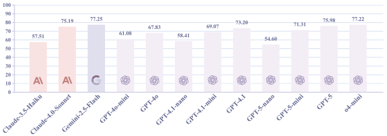
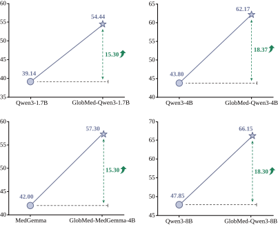

# 🌍 Toward Global Large Language Models in Medicine

<p align="center">
 
 
 
</p>

<p align="center">
  <a href="https://arxiv.org/abs/2601.02186"><b>[📜 Paper]</b></a> •
  <a href="https://huggingface.co/collections/GlobMed"><b>[🤗 HuggingFace]</b></a>
</p>


## 📢 News
- **[2025.01]** 🔥 GlobMed is publicly available through the Hugging Face platform.  

## GlobMed
We introduce GlobMed, the largest multilingual medical dataset to date, spanning 20 languages.

### Scale & Coverage
- **800,000+ entries**
- **20 languages**
  - High-resource: Arabic, Chinese, English, French, German, Hindi, Indonesian, Japanese, Korean, Portuguese, Russian, Spanish, Thai
  - Low-resource: Bengali, Malay, Swahili, Urdu, Wolof, Yoruba, Zulu
 
<p align="center">
  
</p>

### Core Tasks
- **Natural Language Inference:** BioNLI, MedNLI
- **Long-Form Question Answering:** ExpertQA-Bio, ExpertQA-Med, LiveQA 
- **Multiple-choice Question Answering:** HeadQA, MedExpQA, MedQA, MMLU-Pro  

## GlobMed-Bench

Building on GlobMed, we establish GlobMed-Bench, which systematically assesses 56 state-of-the-art LLMs across multiple multilingual medical tasks.

### Evaluation Scope
- **56 state-of-the-art LLMs**
- **40,000+ independent experiments**
- **125M+ generated responses**

- Overall Performance of 12 Proprietary LLMs
    <p align="center">
      
    </p>
- Overall Performance of 44 Open-Weight LLMs
    <p align="center">
      
    </p>
    

### Key Findings
- Proprietary LLMs generally achieve stronger overall performance
- Open-Weight LLMs exhibit significant performance variance and demonstrate a scaling law
- LLMs show significant performance disparities across languages, especially on low-resource languages
- Reasoning-enhanced LLMs consistently outperform non-reasoning counterparts  
- Medical LLMs do not consistently outperform their general counterparts

## GlobMed-LLMs
We introduced GlobMed-LLMs, a suite of multilingual medical LLMs trained on GlobMed, with parameters ranging from 1.7B to 8B.

<p align="center">
  
</p>

## Usage

### Load Dataset

```python
from datasets import load_dataset

# load GlobMed-MMLU-Pro (English)
globmed_mmlu_pro = load_dataset("ruiyang-medinfo/GlobMed_MMLU-Pro", "en")

globmed_mmlu_pro_train = globmed_mmlu_pro["train"]
globmed_mmlu_pro_test = globmed_mmlu_pro["test"]
```
## Contact
- **Rui Yang**: yang.rui@duke-nus.edu.sg
- **Weihao Xuan**: xuan@ms.k.u-tokyo.ac.jp

## Citation
```
@article{yang2026toward,
  title={Toward Global Large Language Models in Medicine},
  author={Yang, Rui and Li, Huitao and Xuan, Weihao and Qi, Heli and Li, Xin and Yu, Kunyu and Chen, Yingjian and Wang, Rongrong and Behmoaras, Jacques and Cai, Tianxi and others},
  journal={arXiv preprint arXiv:2601.02186},
  year={2026}
}
```

## License
This repository is licensed under the [MIT](https://github.com/microsoft/PEACE/blob/main/LICENSE) license.
