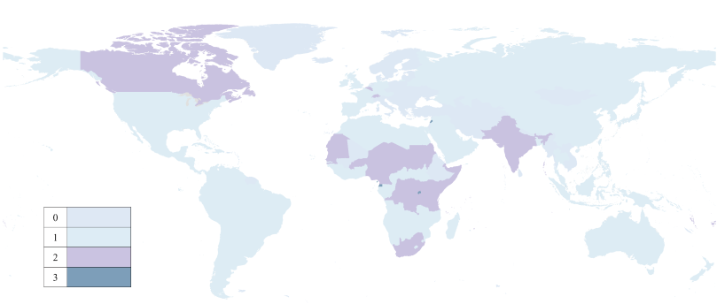
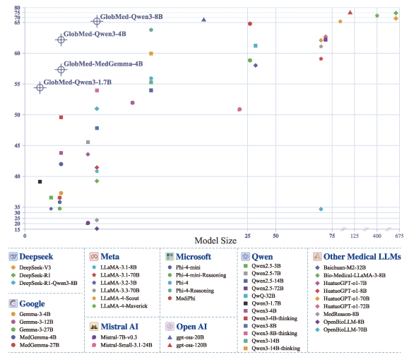

# 🌍 Toward Global Large Language Models in Medicine

<p align="center">
 
 
 
</p>

## 📢 News
- **[2025.01]** 🔥 GlobMed is publicly available through the Hugging Face platform.  

## GlobMed

We introduce GlobMed, the largest multilingual medical dataset to date, spanning 20 languages.

<p align="center">
  
</p>


### Scale & Coverage
- **800,000+ entries**
- **20 languages**
  - High-resource: Arabic, Chinese, English, French, German, Hindi, Indonesian, Japanese, Korean, Portuguese, Russian, Spanish, Thai
  - Low-resource: Bengali, Malay, Swahili, Urdu, Wolof, Yoruba, Zulu

### Core Tasks
- **Natural Language Inference:** BioNLI, MedNLI
- **Long-Form Question Answering:** ExpertQA-Bio, ExpertQA-Med, LiveQA 
- **Multiple-choice Question Answering:** HeadQA, MedExpQA, MedQA, MMLU-Pro  

## GlobMed-Bench

Building on GlobMed, we establish GlobMed-Bench, which systematically assesses 56 state-of-the-art LLMs across multiple multilingual medical tasks.

### Evaluation Scope
- **56 state-of-the-art LLMs**
  - 12 proprietary LLMs
    <p align="center">
      
    </p>
  - 44 open-weight LLMs
    <p align="center">
      
    </p>
- **40,000+ independent experiments**
- **125M+ generated responses**

### Key Findings
- Proprietary LLMs achieve higher average performance but within a narrow range  
- Open-weight LLMs show large variance and strong scaling effects  
- Significant performance disparities across languages, especially on low-resource languages
- Reasoning-enhanced LLMs consistently outperform non-reasoning counterparts  

## Usage

### Load Dataset
GlobMed datasets are hosted on the Hugging Face platform and can be loaded using the `datasets` library.

```python
from datasets import load_dataset

# Load GlobMed-MMLU-Pro dataset (English)
globmed_mmlu_pro = load_dataset("ruiyang-medinfo/GlobMed_MMLU-Pro", "en")

# Access train and test splits
globmed_mmlu_pro_train = globmed_mmlu_pro["train"]
globmed_mmlu_pro_test = globmed_mmlu_pro["test"]
```
## Contact
Rui Yang: yang.rui@duke-nus.edu.sg
Weihao Xuan:
Dr. Nan Liu: 

## Citation
```

```

## License
This repository is licensed under the [MIT](https://github.com/microsoft/PEACE/blob/main/LICENSE) license.
